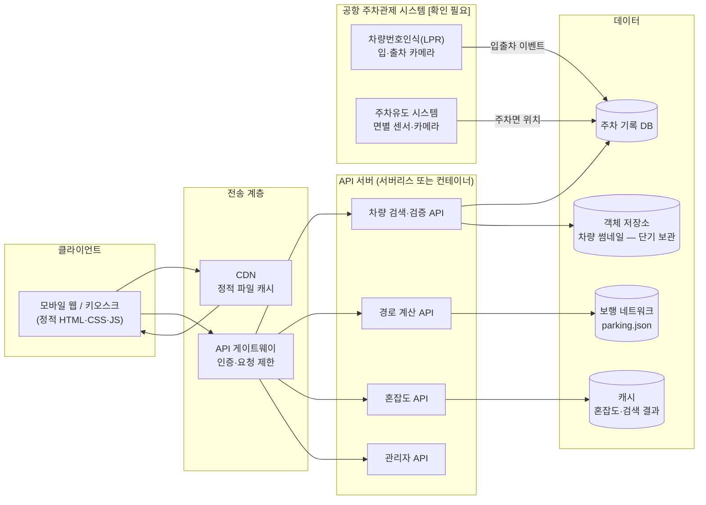
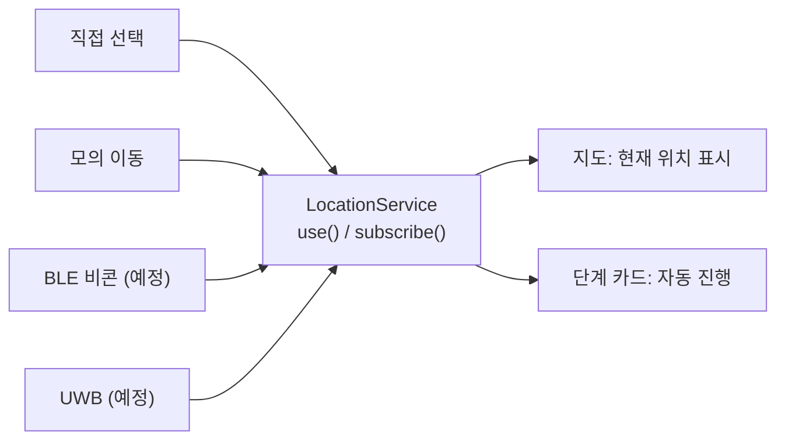

# 인천공항 T1 스마트 내차 찾기 — 사업계획서

> 캡스톤 디자인 프로젝트 · 발표 자료 원고
> **표기 원칙**: 확인되지 않은 수치·공항 내부 사양은 **[가정]** 또는 **[확인 필요]** 로 표시했습니다. 외부 통계를 인용하지 않았으며, 인용이 필요한 곳은 출처 확보 후 채워 넣어야 합니다.

---

## 1. 서비스 개요

### 1.1 문제 정의

| 구분 | 내용 |
|---|---|
| 상황 | 여행·출장에서 돌아온 이용객이 며칠 전 주차한 위치를 기억하지 못함 |
| 공항 특성 | 출입문이 많고(1층 입국장·3층 출국장), 주차장까지 차도·횡단보도를 건너야 함 |
| 기존 방식 | 주차권·사진 메모에 의존, 기억이 없으면 고객센터 문의 또는 직접 수색 |
| 고령층 | 작은 글씨·복잡한 안내판·긴 보행거리로 어려움이 큼 [가정: 사용성 테스트로 검증 필요] |
| 안전 | "가장 가까운 출구"가 차량 동선과 겹치는 경우 보행자 위험 증가 |

### 1.2 해결 방안

| 단계 | 사용자 행동 | 시스템 처리 |
|---|---|---|
| ① 차량 검색 | 차량 번호 뒷 4자리 입력 | 입차 기록에서 후보 차량 조회 |
| ② 차량 확인 | 앞자리·입차 시점·색상·차종 선택 | 후보를 실시간으로 좁히고, 확정 전 번호 마스킹 |
| ③ 경로 안내 | 현재 층·출입문 선택, 길 옵션 선택 | 모든 출입문을 비교해 "안전하고 빠른" 출입문 추천, 단계별 안내 |
| ④ 도착 | 차량 앞 도착 | 주차 위치 요약, 예상 주차요금 확인 |

### 1.3 핵심 기능

| 기능 | 설명 | 차별점 |
|---|---|---|
| 뒷번호 중복 검증 | 같은 뒷 4자리 차량이 여러 대일 때 조건으로 좁힘 | 오안내 방지 + 개인정보 마스킹 |
| 안전 출구 추천 | 보행거리 + 횡단보도 + 차도 인접 + 계단 + 혼잡도 비용으로 출입문 순위 | "가장 가까운 문"이 아닌 "안전하고 빠른 문" |
| 3가지 길 옵션 | 가장 빠른 길 / 가장 안전한 길 / 무장애 경로 | 유모차·휠체어·큰 짐 사용자 배려 |
| 추천 사유 | "○번 출입문보다 30m 멀지만 횡단보도를 1번 덜 건넙니다" | 추천을 납득할 수 있게 설명 |
| 단계별 안내 카드 | 큰 아이콘·한 줄 안내·거리·시간, 지도 구간 강조, 음성 안내 | 고령층 친화 |
| 접근성 | 본문 18px 이상, 버튼 56px 이상, 글씨 3단계, 키보드 조작 | WCAG 2.1 AA 대비 |

### 1.4 캡스톤 피드백 반영 내역 (Before / After)

| 피드백 항목 | Before (이전 프로토타입) | After (현재 버전) |
|---|---|---|
| 배경색 | 어두운 배경 | 흰색·연회색 배경 + 블루 포인트(#0B5CAD), 대비 4.5:1 이상 자동 점검 |
| 글씨 크기 | 12~16px 위주 | 본문 18px 이상, 핵심 안내·차량 번호 28px 이상, 「글씨 크게」 3단계 |
| 경로 안내 | 지도 위 선만 표시 | 단계별 카드 + 현재 구간만 지도 강조 + 이동 방향 화살표 + 음성 안내 |
| 디자인 | 개인 프로젝트 느낌 | 공공 서비스형 카드·그리드, 자체 중립 로고, 진행 단계 표시 |
| 출구 추천 | 가장 가까운 출구 | 비용 기반 "안전하고 빠른" 출입문 추천 + 2순위 대비 사유 |
| 뒷번호 중복 | 첫 번째 결과만 표시 | 2단계 검증(앞자리·입차 시점·색상·차종), 남은 후보 수 실시간 표시 |

---

## 2. 시스템 아키텍처

### 2.1 상용 버전 구성도

### 2.2 구성 요소별 역할

| 구성 요소 | 역할 | 비고 |
|---|---|---|
| 클라이언트 | 검색·검증·경로 안내 화면, 지도 렌더링 | 빌드 도구 없는 정적 파일 → CDN 배포 용이 |
| API 게이트웨이 | 인증, 요청 수 제한(무차별 대입 방지) | 클라이언트의 「5회 실패 30초 제한」을 서버에서도 강제 |
| 차량 검색 API | 뒷 4자리 → 후보 목록(마스킹), 확정 시 위치 반환 | 확정 전에는 전체 번호·위치 미전송 |
| 경로 계산 API | 보행 네트워크 + 가중치로 출입문 추천 | 현재는 클라이언트에서 계산(router.js) |
| 혼잡도 API | 출입문별 혼잡도 제공 | router.js 의 `setCongestionProvider()` 로 교체 |
| LPR 연동 | 입·출차 시각, 차량 번호, 사진 | 연동 방식·데이터 형식 [확인 필요] |
| 주차유도 시스템 연동 | 차량이 주차된 면·기둥 위치 | 면 단위 위치 제공 여부 [확인 필요] |
| DB | 입차 기록, 검색 로그(익명화) | 보관 기간 정책은 3.1 참고 |

### 2.3 현재 프로토타입과 상용 버전의 차이

| 항목 | 현재 프로토타입 (목업) | 상용 버전 |
|---|---|---|
| 차량 데이터 | `data/vehicles.json` 가상 차량 33대 | LPR·주차유도 시스템 실시간 연동 |
| 주차장 도면 | `data/parking.json` 가상 SVG 좌표 | 현장 실측 도면 기반 좌표 |
| 혼잡도 | 고정 목업 값(0~1) | 출입문 유동인구 센서·CCTV 분석 [가정] |
| 경로 계산 | 브라우저에서 다익스트라 | 서버 또는 브라우저 (도면 크기에 따라 결정) |
| 현재 위치 | 사용자가 층·출입문 직접 선택 / 모의 이동 | BLE 비콘·UWB 등 실내 측위 (5장) |
| 보안 | 클라이언트 측 입력 제한·마스킹 | 서버 측 인증·요청 제한·감사 로그 |
| 주차요금 | 목업 요금 체계 | 공항 정산 시스템 연동 [확인 필요] |
| 배포 | 로컬 서버(start.bat) / 정적 호스팅 | CDN + 이중화된 API |

---

## 3. 인천공항 유지보수 및 비용 관리

### 3.1 기술 고려사항

| 항목 | 고려 내용 | 상태 |
|---|---|---|
| 주차관제 시스템 연동 | 기존 LPR·주차유도 시스템의 데이터 제공 방식(API, DB 복제, 파일 연계 등) 확인 후 **읽기 전용** 연동 | [확인 필요] 운영사·인터페이스 사양 |
| 연동 데이터 범위 | 입차 시각, 차량 번호, 주차 구역·기둥(또는 면) 위치, 차량 사진 | [확인 필요] 면 단위 위치 제공 여부 |
| 이중화 | API 서버 다중 가용영역 배치, DB 복제 | 설계 단계 |
| 오프라인 폴백 | 연동 장애 시: ① 마지막 동기화 데이터로 검색(“기준 시각” 표시) ② 지도·경로 안내는 정적 파일만으로 동작 ③ 고객센터 연결 안내 | 현재 구조가 정적 지도·경로를 지원 |
| 명절·성수기 트래픽 | 정적 파일은 CDN 캐시, 검색 API는 오토스케일링, 혼잡도는 짧은 주기 캐시 | 피크 배수는 [가정] — 공항 주차 통계 확보 필요 |
| 개인정보 — 차량번호 | 차량번호는 다른 정보와 결합 시 개인을 식별할 수 있어 개인정보로 취급 | 법률 검토 [확인 필요] |
| 개인정보 — 영상 | 주차장 카메라 영상은 영상정보처리기기 관련 규정 적용 대상 | 보관 기간·파기 절차는 공항 운영방침에 따름 [확인 필요] |
| 보관·파기 원칙 | 서비스 DB에는 출차 후 즉시 또는 최소 기간만 보관, 썸네일은 저해상도·단기 보관 후 자동 파기, 검색 로그는 번호를 해시 처리 | 구체 기간 [확인 필요] |
| 보안 점검 | 정기 취약점 점검, 요청 제한, 관리자 접근 통제, 감사 로그 | 공공기관 보안 지침 적용 범위 [확인 필요] |
| 접근성 인증 | 국내 웹 접근성 품질인증 대비 (현재 WCAG 2.1 AA 기준 자체 점검) | 인증 기준 버전 [확인 필요] |

### 3.2 클라우드 비용 절감 전략

| 전략 | 방법 | 기대 효과 |
|---|---|---|
| 정적 파일 CDN | HTML·CSS·JS·지도 데이터를 CDN에서 제공 | 서버 요청 감소, 트래픽 급증에 강함 |
| 서버리스 | 검색·경로 API를 요청당 과금 함수로 구성 | 야간 등 한가한 시간 비용 최소화 |
| 오토스케일링 + 예약 인스턴스 | 상시 부하는 예약 인스턴스, 피크는 오토스케일링 | 상시 비용 할인 + 피크 대응 |
| 캐싱 | 혼잡도·도면·검색 결과 단기 캐시 | DB 조회 감소 |
| 이미지 최적화 | 썸네일 압축(작은 해상도), 보관 기간 단축, 자동 삭제 규칙 | 저장·전송 비용 감소 + 개인정보 위험 감소 |
| 공공 클라우드 | 공공기관 도입 시 클라우드 보안인증(CSAP) 받은 서비스 고려 | 도입 요건 충족 [확인 필요: 적용 대상 여부] |

### 3.3 트래픽 시나리오별 월 비용 범위 **[가정]**

> 아래 값은 **실제 견적이 아닌 가정**입니다. 클라우드 사업자·요금제·환율·계약 조건에 따라 크게 달라지므로, 도입 전 사업자 견적으로 교체해야 합니다.

| 시나리오 | 가정 조건 | 주요 구성 | 월 비용 범위 [가정] |
|---|---|---|---|
| 소 (파일럿) | 하루 검색 수천 건 이하, 단일 주차장 | CDN + 서버리스 API + 소형 DB | 수만 원 ~ 수십만 원 |
| 중 (T1 전체) | 하루 검색 수만 건, 명절 피크 수 배 | CDN + 서버리스/소형 컨테이너 + 이중화 DB + 캐시 | 수십만 원 ~ 수백만 원 |
| 대 (T1·T2 + 썸네일) | 하루 검색 수십만 건, 썸네일 저장·전송 | CDN + 오토스케일 컨테이너 + 이중화 DB + 캐시 + 객체 저장소 + 보안 서비스 | 수백만 원 ~ 천만 원대 |

| 비용 산정 시 확인할 항목 | 이유 |
|---|---|
| 일 평균·최대 주차 대수 [확인 필요] | 검색 요청 수 추정 근거 |
| 피크 시간대 배수 [확인 필요] | 오토스케일링 상한 설계 |
| 썸네일 크기·보관 기간 | 저장·전송 비용의 가장 큰 변수 |
| 공공 클라우드 요금 체계 | 일반 퍼블릭 클라우드와 다를 수 있음 |

---

## 4. 타겟 시장 확대 (B2B / B2G)

### 4.1 타겟별 분석

| 타겟 | 고객 문제 | 도입 가치 | 의사결정자 [가정] | 수익 모델 |
|---|---|---|---|---|
| 대형 공영주차장 | 넓은 부지, 민원 다수 | 민원 감소, 시민 편의 | 지자체 교통 부서·시설공단 | 구축비 + 유지보수 |
| 복합쇼핑몰 | 층·구역이 비슷해 차량 위치 혼동 | 고객 체류 경험 개선, 출차 지연 감소 | 시설·운영 총괄 | SaaS 월 구독 + 광고·제휴(매장 쿠폰) |
| 대형 놀이공원·테마파크 | 장시간 체류 후 위치 망각, 가족 단위 | 귀가 동선 만족도 향상 | 운영본부 | SaaS 월 구독 + 제휴 |
| 대학병원 | 고령·환자·보호자 이용, 보행 안전 | 무장애 경로, 고령층 접근성 | 시설관리팀·원무 부서 | 구축비 + 유지보수 |
| 컨벤션센터·경기장 | 행사 종료 시 일시 집중 | 출차·보행 분산, 안전 | 운영사·행사 주최 | 행사 단위 라이선스 + 제휴 |
| KTX 역사 환승주차장 | 장기 주차, 시간 압박 | 열차 시간 내 빠른 차량 찾기 | 철도 운영기관·주차 위탁사 | 구축비 + 유지보수 |
| 대단지 아파트 | 지하 다층 주차장, 방문차량 | 입주민 편의, 방문객 안내 | 관리사무소·입주자대표회의 | SaaS 월 구독 (세대당 소액) |

### 4.2 수익 모델 비교

| 모델 | 구조 | 적합 고객 | 장점 | 유의점 |
|---|---|---|---|---|
| SaaS 월 구독 | 주차면 수·사용량 기준 월 과금 | 쇼핑몰, 테마파크, 아파트 | 반복 매출 | 초기 고객 확보 필요 |
| 구축비 + 유지보수 | 1회 구축 + 연간 유지보수 계약 | 공공·병원·역사 | 공공 조달 구조에 적합 | 영업 주기 김 |
| 광고·제휴 | 도착 화면 쿠폰, 매장 제휴 | 쇼핑몰, 테마파크 | 사용자 무료 유지 | 공공시설에는 부적합할 수 있음 |

### 4.3 3개년 로드맵

| 연차 | 목표 | 주요 활동 | 성과 지표 |
|---|---|---|---|
| 1년차 — 파일럿 | 한 곳에서 효과 검증 | 1개 시설(예: 공영주차장 또는 병원) 실측·연동, 고령층 사용성 테스트 | 차량 찾기 시간 단축률, 문의 감소율 (7장) |
| 2년차 — 확산 | 업종별 표준 패키지 | 쇼핑몰·병원·역사 등 3~5개 시설 도입 [가정], 관리자 대시보드 고도화 | 도입 시설 수, 재계약률 |
| 3년차 — 플랫폼화 | 여러 시설을 하나의 앱·API로 | 시설별 도면·연동 모듈화, 외부 지도·내비 앱과 API 제휴 | API 호출량, 제휴사 수 |

---

## 5. 미래 기술 연동 (GPS 음영 지역 극복)

실내·지하 주차장과 터미널 내부는 GPS 신호가 약하거나 오차가 커서 기둥 단위 안내에 쓰기 어렵습니다. 그래서 실내 측위 기술을 단계적으로 도입합니다.

### 5.1 실내 위치 기술 비교 **[일반적 특성 — 현장 검증 필요]**

| 기술 | 정확도 (일반적 범위) | 구축비 | 유지보수 부담 | 스마트폰 지원 범위 |
|---|---|---|---|---|
| BLE 비콘 | 수 m 수준 | 낮음~중간 | 배터리 교체·위치 보정 필요 | 대부분 지원, 단 **웹 브라우저에서는 스캔 제한** → 앱 필요 |
| UWB | 수십 cm 수준 | 높음 | 앵커 전원·보정 | 일부 최신 기종만 지원 |
| Wi-Fi RTT | 1~2 m 수준 | 중간 (지원 AP 필요) | AP 관리 | 일부 기종·OS만 지원 |
| 실내 AR 내비게이션 | 시각 측위 품질에 좌우 | 중간~높음 (공간 스캔) | 공간 변경 시 재스캔 | AR 지원 기종, 카메라 사용 동의 필요 |
| 주차면 센서·카메라 | 차량 위치 자체는 면 단위로 정확 | 높음 (면마다 설치) | 장비 점검 | 사용자 기기와 무관 (서버 데이터) |

> 정확도·지원 범위 수치는 일반적으로 알려진 범위이며, 현장 구조(기둥·차량·금속)에 따라 달라지므로 **현장 실측으로 검증해야 합니다.**

### 5.2 단계적 도입 계획

| 단계 | 기술 | 적용 위치 | 목적 |
|---|---|---|---|
| 1단계 | BLE 비콘 | 출입문·엘리베이터·주요 교차점 | "지금 계신 곳" 자동 선택, 단계 자동 진행 |
| 2단계 | UWB 고정밀 구역 | 기둥이 밀집한 구역, 혼동이 잦은 구역 | 기둥 단위 정밀 안내 |
| 3단계 | AR 안내 | 지원 기기 사용자 | 카메라 화면 위 화살표 안내 |
| 병행 | 주차면 센서·카메라 | 주차유도 시스템 연동 | 차량 위치 자동 확정 (사용자 입력 최소화) |

### 5.3 LocationProvider 인터페이스가 확장을 받쳐주는 방식

현재 `js/location.js` 는 모든 위치 공급자가 **같은 모양**을 갖도록 설계되어 있습니다.

| 메서드 / 값 | 의미 |
|---|---|
| `isAvailable()` | 이 기기·환경에서 사용할 수 있는지 |
| `start(onUpdate)` | 위치가 바뀔 때마다 `onUpdate(position)` 호출 |
| `stop()` | 위치 추적 중지 |
| `position` | `{ x, y, floor, nodeId?, accuracyM, source, timestamp }` — 좌표는 지도(SVG) 좌표 |

| 공급자 | 상태 | 설명 |
|---|---|---|
| `ManualLocationProvider` | 구현됨 | 사용자가 층·출입문 직접 선택 |
| `SimulatedLocationProvider` | 구현됨 | 경로를 따라 실시간 이동 시연 (발표용) |
| `BleBeaconLocationProvider` | 자리만 있음 | 비콘 id → SVG 좌표 변환표만 추가하면 연결 |
| UWB / Wi-Fi RTT / AR 공급자 | 예정 | 같은 인터페이스로 추가 |

**효과**: 화면(지도·단계 카드)과 경로 계산 코드는 바꾸지 않고, 새 측위 기술을 공급자 하나로 추가할 수 있습니다. 현장마다 다른 장비를 써도 같은 앱을 재사용할 수 있어 4장의 플랫폼화와도 연결됩니다.

---

## 6. 리스크 및 대응

| 리스크 | 내용 | 영향 | 대응 |
|---|---|---|---|
| 공항 데이터 접근 권한 | LPR·주차유도 데이터 제공 여부와 범위가 불확실 | 높음 | ① 읽기 전용·최소 항목 요청 ② 파일럿은 공영주차장 등 접근이 쉬운 곳에서 시작 ③ 데이터 없이도 쓸 수 있는 "사용자 직접 입력 위치 저장" 대안 |
| 개인정보 | 차량번호·영상은 민감하게 다뤄야 함 | 높음 | 확정 전 마스킹, 검색 횟수 제한, 로그 해시 처리, 최소 보관·자동 파기, 개인정보 영향평가 [확인 필요] |
| 현장 실측 데이터 부족 | 현재 도면·거리·혼잡도는 목업 | 중간 | 현장 실측 → `parking.json` 교체 (코드 변경 없이 데이터만 교체 가능한 구조) |
| 기존 사업자와의 관계 | 공항 주차관제·안내 시스템 운영사와 역할 중복 우려 | 중간 | 경쟁이 아닌 "보행 안내 계층"으로 포지셔닝, 기존 시스템 데이터 활용·공동 제안 |
| 측위 정확도 | 실내에서 위치 오차 발생 | 중간 | 단계 카드 수동 진행을 기본으로 유지, 측위는 보조 수단 |
| 접근성 미흡 | 고령층·장애인 사용 실패 | 중간 | 정기 사용성 테스트, 접근성 인증 준비 |

---

## 7. 향후 일정 및 KPI

### 7.1 향후 일정 **[가정]**

| 시기 | 내용 |
|---|---|
| 1~2개월 | 관리자 대시보드, 현장 실측 계획 수립, 고령층 사용성 테스트 1차 |
| 3~4개월 | 파일럿 시설 선정·실측, `parking.json` 실데이터 교체 |
| 5~6개월 | 주차 기록 연동(가능 범위), BLE 비콘 시범 설치 |
| 7개월 이후 | 파일럿 운영·KPI 측정, 확산 패키지 준비 |

### 7.2 KPI 정의

| KPI | 정의 | 측정 방법 | 목표값 |
|---|---|---|---|
| 평균 차량 찾기 시간 단축률 | (도입 전 평균 − 도입 후 평균) ÷ 도입 전 평균 | 도입 전: 현장 관찰·설문 / 도입 후: 검색 시작 ~ 「도착했어요」 시간 | [가정] 파일럿 측정 후 설정 — 기준값(도입 전) 확보가 먼저 |
| 고객센터 문의 감소율 | 차량 위치 관련 문의 건수 변화 | 고객센터 문의 분류 데이터 (협조 필요) | [가정] 기준값 확보 후 설정 |
| 고령층 사용성 테스트 | 과제 성공률, 소요 시간, 도움 요청 횟수, 만족도 | 65세 이상 참여자 대상 과제 수행 테스트 [가정: 참여자 수 협의] | 과제 성공률 목표는 1차 테스트 후 설정 |
| 검색 실패율 | 0대 결과 비율 | 서비스 로그 (익명) | 낮을수록 좋음 — 원인 분석(입력 오류 / 다른 터미널) |
| 안전 경로 선택률 | 「가장 안전한 길」·「무장애」 선택 비율 | 서비스 로그 | 참고 지표 |

> 모든 목표값은 **도입 전 기준값을 실제로 측정한 뒤** 정해야 합니다. 근거 없는 목표 수치는 넣지 않았습니다.
